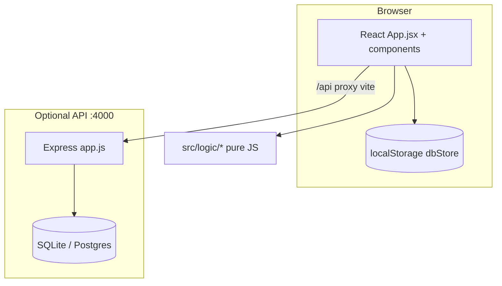

# Kiến trúc hệ thống — lichkhoa-webapp

## Sơ đồ tổng quan

## Frontend

| Khu vực | Vai trò |
|---------|---------|
| `src/App.jsx` | Orchestration: tab, sheet state, persist |
| `src/components/*` | Lịch tuần/tháng, toolbar, modals |
| `src/logic/*` | Nghiệp vụ thuần: schedule, cảnh báo, merge, access |
| `src/store/dbStore.js` | Seed & persist department JSON |
| `src/features/account/*` | Auth UI + `accountApi` |

## Backend

| Route prefix | Module |
|--------------|--------|
| `/api/auth` | Register, login, Google, me |
| `/api/profile` | Hồ sơ, avatar |
| `/api/settings` | Cài đặt, mật khẩu |

Validators: Zod trong `server/src/validators/profileValidator.js`.

## Dữ liệu lịch (client)

Một **department** gồm: `staff[]`, `tasks[]`, sheets (week/month/…), grids, warnings, BU ledger fields. Không đồng bộ server trừ khi feature mới spec rõ (hiện tại out of scope).

## Quy ước mở rộng

1. Logic nghiệp vụ **ưu tiên** `src/logic/` (testable, không JSX).
2. API mới: route → controller → service → Prisma; spec mô tả status code & body.
3. Feature flag: chưa dùng; nếu cần ghi trong design feature.
