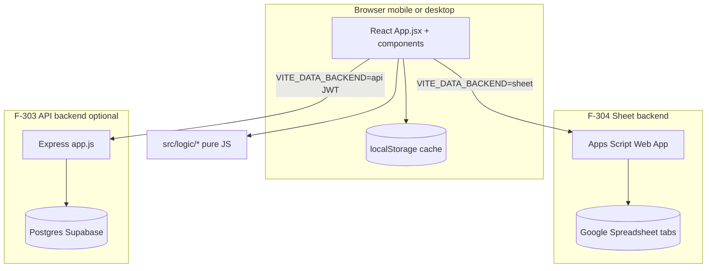

# Kiến trúc hệ thống — lichkhoa-webapp

## Sơ đồ tổng quan

## Frontend

| Khu vực | Vai trò |
|---------|---------|
| `src/App.jsx` | Orchestration: tab, sheet state, persist |
| `src/components/*` | Lịch tuần/tháng, toolbar, modals |
| `src/logic/*` | Nghiệp vụ thuần: schedule, cảnh báo, merge, access |
| `src/logic/sheetStore/` | Import/export tab Google Sheet ↔ store JSON (F-304) |
| `src/store/dbStore.js` | Seed & persist department JSON |
| `src/features/sheetSync/` | Gọi Apps Script bridge (F-304) |
| `src/features/scheduleSync/` | Gọi API Postgres (F-303) |
| `src/features/account/*` | Auth UI + Google / JWT |

## Backend

| Route prefix | Module |
|--------------|--------|
| `/api/auth` | Register, login, Google, me |
| `/api/profile` | Hồ sơ, avatar |
| `/api/settings` | Cài đặt, mật khẩu |
| `/api/schedule-store` | GET/PUT snapshot lịch (F-303) |

Validators: Zod trong `server/src/validators/*`.

## Dữ liệu lịch

Một **department** gồm: `staff[]`, `tasks[]`, sheets (week/month/…), grids, warnings, BU ledger fields.

- **Cache:** `localStorage` (`LICHKHOA_DATA_STORE_V1`)
- **F-304 (mặc định khuyến nghị khoa tự chủ):** tab Sheet `NhanSu`, `Task`, `LichTuan`, … — [DEPLOY-GOOGLE-SHEETS.md](../DEPLOY-GOOGLE-SHEETS.md)
- **F-303:** Postgres Supabase qua `ScheduleStore` — [DEPLOY-SUPABASE.md](../DEPLOY-SUPABASE.md)

Env: `VITE_DATA_BACKEND=sheet|api`.

## Quy ước mở rộng

1. Logic nghiệp vụ **ưu tiên** `src/logic/` (testable, không JSX).
2. API mới: route → controller → service → Prisma; spec mô tả status code & body.
3. Feature flag: `VITE_DATA_BACKEND` cho nguồn sync.
