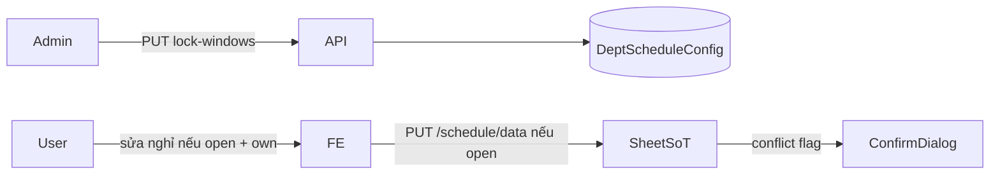

# Design — F-214: Cửa sổ khóa lịch nghỉ

## Tổng quan

## Thành phần

| Layer | File / module | Trách nhiệm |
|-------|---------------|-------------|
| Logic | `src/logic/editWindows.js` | `isLeaveWindowOpen`, `isMonthWindowOpen`, parse ISO |
| Logic | `src/logic/leaveOwnership.js` | Keys từ staff/roster; `canMutateLeaveEntry` |
| API | `scheduleConfigService.js` | Serialize lock fields; `saveLockWindows` |
| API | `requireScheduleWrite.js` | Admin/Mod luôn; User khi leave window open |
| UI | `LockWindowSettings.jsx` | Form Admin + hiển thị hạn |
| UI | `App.jsx` / `SheetView.jsx` | `canWriteSheet`, gate save/delete, banner |

## Luồng dữ liệu

1. Admin lưu hạn → Prisma → mọi client GET config thấy ISO.
2. User mở tab nghỉ → FE tính `leaveOpen` + ownership → DayCalendar readOnly nếu khóa.
3. User lưu nghỉ hợp lệ → store đổi → persist F-210 (canWrite=true khi open) → LWW/conflict dialog như Mod.

## Mô hình dữ liệu

`DeptScheduleConfig`:

| Field | Type | Note |
|-------|------|------|
| leaveLockAt | DateTime? | Hạn tuyệt đối; null = mở |
| monthLockAt | DateTime? | Lưu cho Epic 4.3; F-214 chỉ hiển thị |

## Lỗi & edge cases

| Tình huống | Xử lý |
|------------|--------|
| Chưa có row config | GET trả lock null; PUT lock-windows upsert (spreadsheetId `""` nếu tạo mới) |
| User week:edit trong cửa sổ | Có thể sync cả lưới tuần (v1 chấp nhận; patch leave-only = follow-up) |
| F-304 sheet backend | Không áp dụng canWrite F-210; lock UI vẫn hiện nếu API config có |

## Bảo mật / quyền

- Lock-windows: `requireAdmin`
- Data PUT: `requireScheduleWrite` thay `requireModOrAdmin`
- Ownership chỉ enforce client (v1); server tin User trong cửa sổ như tin Mod
