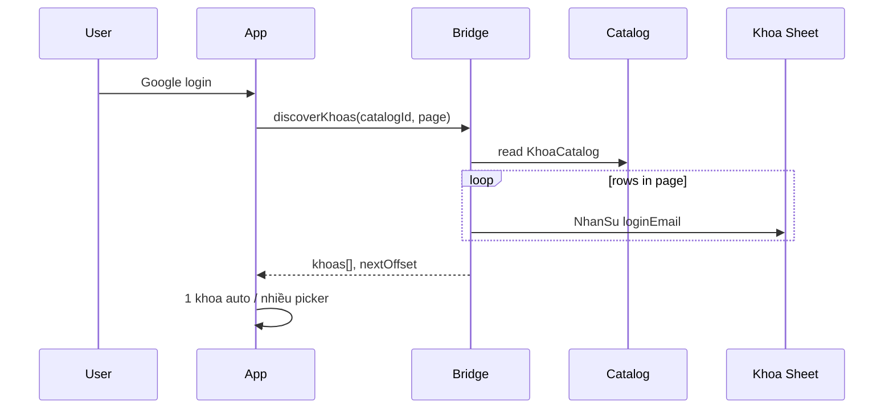

# F-306 — Design

## Catalog Sheet (IT)

Một Spreadsheet bệnh viện, tab **`KhoaCatalog`**:

| slug | label | spreadsheetId | active |
|------|-------|---------------|--------|
| tim-mach | Khoa Tim mạch | 1ABC… | yes |
| tieu-hoa | Khoa Tiêu hóa | 1XYZ… | yes |

Bridge deploy cần **Editor** trên catalog + mỗi file khoa.

## Cloudflare

| Biến | Mô tả |
|------|--------|
| `VITE_HOSPITAL_CATALOG_SHEET_ID` | ID file catalog (một dòng) |

## FE flow

## Files

- `src/config/hospitalCatalog.js`
- `src/features/sheetSync/useKhoaDiscovery.js`
- `src/features/sheetSync/KhoaDiscoveryDialog.jsx`
- `google-apps-script/Code.gs` — `discoverKhoas`